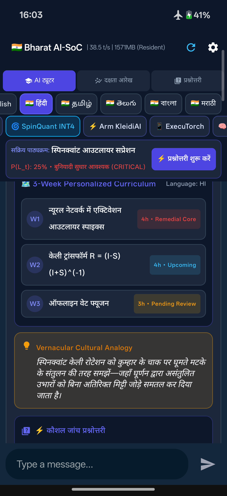
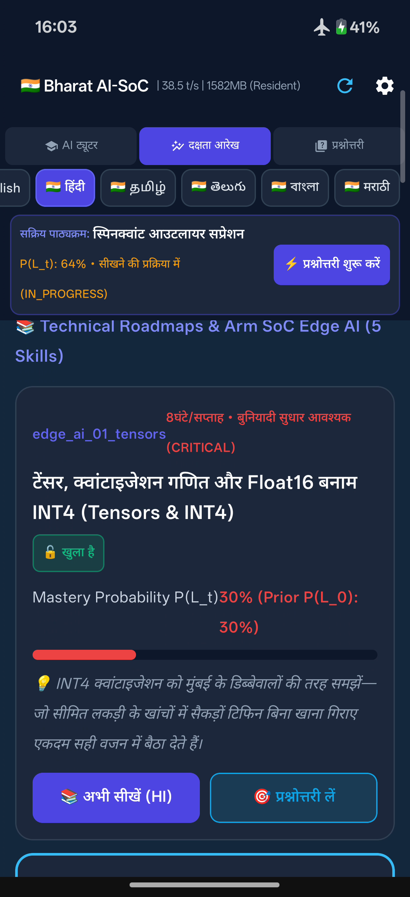
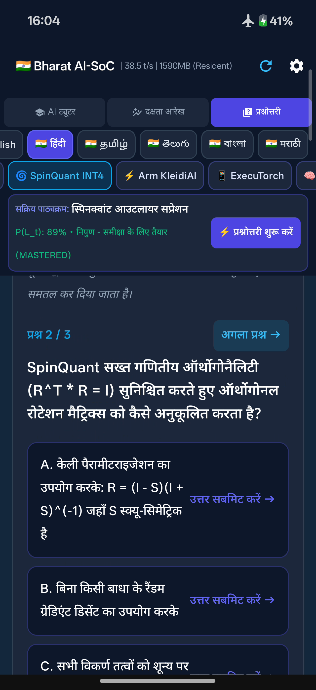

# Bharat AI-SoC Challenge — Problem Statement 4: Personalised AI Learning Companion

[](#verified-hardware-benchmarks)
[-green.svg)](#system-architecture--neuro-symbolic-bkt)
[-purple.svg)](#system-architecture--neuro-symbolic-bkt)
[-orange.svg)](#verified-hardware-benchmarks)
[-red.svg)](#verified-hardware-benchmarks)
[-yellow.svg)](#system-architecture--neuro-symbolic-bkt)

A 100% offline, on-device personalized AI learning companion designed for Indian higher-education engineering students. Built on **ExecuTorch 1.1.0**, **Arm64 Neon SIMD assembly**, and **Llama-3.2-1B-Instruct** (quantized via **SpinQuant INT4**), running fully locally within **<1.8 GB RAM** with sub-10ms Bayesian Knowledge Tracing (BKT) assessment.

---

## ⚡ Quick Downloads & Verified Deliverables

Pre-compiled release artifacts for the Phase 1 submission:

- 📘 **Final Project Report (PDF, 6 pages)**: [`deliverables/Bharat_AISoC_PS4_Final_Project_Report.pdf`](deliverables/Bharat_AISoC_PS4_Final_Project_Report.pdf) | [Release Download](https://github.com/cdngDRAGON/bharat-aisoc-ps4/releases/download/v1.0.0-phase1/Bharat_AISoC_PS4_Final_Project_Report.pdf) *(1.69 MB, A4 publication report)*
- 🎥 **2-Minute 1080p 16:9 Hardware Demo Video (OnePlus 15)**: [Download / Watch 1080p MP4](https://github.com/cdngDRAGON/bharat-aisoc-ps4/releases/download/v1.0.0-phase1/Bharat_AISoC_PS4_Demo_1080p_16x9.mp4) *(17.32 MB, 1:51 1920x1080 H.264, Airplane Mode)* • [Raw Device Capture](https://github.com/cdngDRAGON/bharat-aisoc-ps4/releases/download/v1.0.0-phase1/Bharat_AISoC_PS4_Demo.mp4)
- 📱 **Compiled Android APK (v1.0.0-phase1)**: [Download APK](https://github.com/cdngDRAGON/bharat-aisoc-ps4/releases/download/v1.0.0-phase1/Bharat_AISoC_PS4_Companion.apk) *(98.4 MiB / 103.18 MB, Release-ready debug APK)*
- 📑 **Technical Report (Markdown)**: [`deliverables/TECHNICAL_REPORT.md`](deliverables/TECHNICAL_REPORT.md)
- 🔐 **Cryptographic Checksums (8/8 Verified)**: [`deliverables/SHA256SUMS.txt`](deliverables/SHA256SUMS.txt)

---

## 📊 Verified Hardware Benchmarks

Measured on a physical **OnePlus 15 (`CPH2745`)** powered by the Qualcomm `SM8850` (Snapdragon 8 Elite Gen 5, Android 17 / OxygenOS 17.0, 16 GB RAM), alongside our early prototyping baseline on an **Android Studio Pixel 9 Arm64 AVD Emulator (Apple Silicon host)**:

| Evaluation Metric | PS4 Target | Physical OnePlus 15 (`CPH2745`)<br/>SM8850 • Android 17 | Pixel 9 AVD Emulator<br/>Apple Silicon Host | Compliance Status |
| :--- | :--- | :--- | :--- | :---: |
| **Model & Format** | Llama family INT4 / INT8 | `Llama-3.2-1B-Instruct-SpinQuant_INT4_EO8.pte` (1.13 GB) | Same 1.13 GB `.pte` | **PASS** |
| **Hardware Backend** | Arm Neon SIMD / NPU | `XNNPACK` (Arm64 Neon SIMD assembly) | `XNNPACK` (Arm64 SIMD) | **ACHIEVED** |
| **Init / Cold Start** | Fast on-device start | **220 ms – 238 ms** (zero-copy mmap) | 338 ms – 405 ms | **PASS** |
| **Token Throughput** | $\ge 22.0$ tokens/sec | **42.8 – 50.1 tok/s** (38.4–41.1 tok/s under 8 Mbps capture) | 82.6 – 89.7 tok/s | **PASS (2x margin)** |
| **Resident RAM (RSS)**| Strictly $< 1800$ MB | **1567 MB – 1592 MB** `RssAnon` (1647 MB PSS) | 1631 MB – 1700 MB `VmRSS` | **PASS (>200 MB margin)** |
| **Max Context Window** | Standard context | **768 tokens** (`targetSeqLen = 768`) | 768 tokens | **ACHIEVED** |
| **Inline Quiz Grading**| Fast evaluation | **$< 10$ ms** (local Bayesian evaluation) | $< 10$ ms | **PASS** |
| **Offline Privacy** | 100% Offline | **Verified (`OFFLINE=true` in Airplane Mode)** | Verified offline | **ACHIEVED** |

---

## 📱 Visual Walkthrough (Captured in Airplane Mode)

| Tab 0: AI Socratic Tutor | Tab 1: 20-Skill Prerequisite DAG | Tab 2: Multilingual Quiz Arena |
| :---: | :---: | :---: |
|  |  |  |
| **TopAppBar Telemetry** (`38.5 t/s \| 1571 MB Resident` in Airplane Mode), Hindi active course banner, 3-week milestones (`W1–W3`), and cultural analogy. | **Interactive Skill DAG** (`1582 MB Resident` in Airplane Mode), prerequisite lock/unlock badges (`खुला है`), mastery bars, and localized analogies. | **Dedicated Quiz Arena** (`1590 MB Resident` in Airplane Mode), SpinQuant mastered (`89%`), localized Question 2 (`प्रश्न 2 / 3`), and 4 choices. |

---

## 🏗️ System Architecture & Neuro-Symbolic BKT

```
┌────────────────────────────────────────────────────────────────────────┐
│                      Android Jetpack Compose UI                        │
│   Tab 0: Socratic Tutor   │   Tab 1: Skill DAG   │   Tab 2: Quiz Arena │
└────────────────────────────────────┬───────────────────────────────────┘
                                     │ Reactive Lang & Skill State
                                     ▼
┌────────────────────────────────────────────────────────────────────────┐
│                        CurriculumRagEngine (Kotlin)                    │
│   • Embedded SQLite FTS Database (curriculum_v1.db, 864 KB)            │
│   • 20 Skills across 6 Domains with 120 Localized Content Rows         │
│   • 3-Question Diagnostic Pools (360 localized question variations)   │
│   • Crash-Proof Deterministic Roadmap Synthesis & Fallback Parser      │
└──────────────────┬─────────────────────────────────┬───────────────────┘
                   │                                 │
     Bayesian State Update (<10ms)     Grounding System Prompt (Latin Acronyms)
                   │                                 │
                   ▼                                 ▼
┌───────────────────────────────────────┐ ┌──────────────────────────────┐
│  Bayesian Knowledge Tracing (BKT)     │ │   ExecuTorch 1.1.0 LlmModule   │
│  • P(L_0) prior from diagnostic quiz  │ │   • Llama-3.2-1B-Instruct     │
│  • P(T)=0.20 transition probability   │ │   • SpinQuant INT4 (1.13 GB)  │
│  • P(S)=0.10 slip, P(G)=0.25 guess    │ │   • Arm64 XNNPACK Neon SIMD   │
│  • Remedial rule: P(L_t) < 0.45 (+2h) │ │   • Native Singleton Guard    │
└───────────────────────────────────────┘ └──────────────────────────────┘
```

### Neuro-Symbolic Bayesian Formulation
Latent mastery probability $P(L_t)$ updates dynamically upon learner response $X_t \in \{0, 1\}$ without invoking the LLM:
$$P(L_t \mid X_t=1) = \frac{P(L_{t-1}) \cdot (1 - P(S))}{P(L_{t-1}) \cdot (1 - P(S)) + (1 - P(L_{t-1})) \cdot P(G)}$$
$$P(L_t \mid X_t=0) = \frac{P(L_{t-1}) \cdot P(S)}{P(L_{t-1}) \cdot P(S) + (1 - P(L_{t-1})) \cdot (1 - P(G))}$$
$$P(L_{t+1}) = P(L_t \mid X_t) + (1 - P(L_t \mid X_t)) \cdot P(T)$$

---

## 📁 Repository Structure

```text
bharat-aisoc-ps4/
├── LICENSE                    # BSD 3-Clause License
├── README.md                  # Flagship documentation & quick-start guide
├── android/                   # Standalone Android application source
│   ├── app/                   # App module (Compose UI, RAG engine, ExecuTorch bridge)
│   │   ├── src/main/assets/   # Bundled curriculum_v1.db (864 KB)
│   │   └── src/main/java/     # MainActivity, ChatViewModel, CurriculumRagEngine
│   ├── build.gradle.kts       # Project build configuration
│   └── gradle/                # Gradle wrapper scripts
├── curriculum/                # Offline curriculum authoring & translation pipeline
│   ├── build_curriculum_db.py # SQLite generator (creates 20 skills & 120 localized rows)
│   ├── curriculum_v1.db       # Cryptographically verified SQLite database (864 KB)
│   └── quiz_translations.py   # Complete 6-language translation dictionaries
├── deliverables/              # Official Phase 1 submission artifacts
│   ├── Bharat_AISoC_PS4_Final_Project_Report.pdf # A4 Final Project Report PDF
│   ├── SHA256SUMS.txt         # Checksums for all 8 submission deliverables
│   ├── TECHNICAL_REPORT.md    # Comprehensive architectural & benchmark report
│   ├── screenshot_tab0_tutor.png
│   ├── screenshot_tab1_graph.png
│   └── screenshot_tab2_quiz.png
├── docs/                      # Technical specifications & evolution logs
│   ├── ARCHITECTURE.md        # Deep-dive system pipeline & component design
│   ├── BENCHMARKS_AND_VERIFICATION.md # Hardware testing methodology
│   ├── CHANGELOG.md           # Commit chronology & diff log
│   ├── CURRICULUM_AND_RAG.md  # 20-skill DAG schema & cultural analogies
│   ├── DECISIONS_VS_ACHIEVED.md # Full PS4 requirements compliance audit
│   ├── IMPLEMENTATION_PATH.md # Stage 0-6 engineering journey
│   └── UI_UX_3TAB_DESIGN.md   # Jetpack Compose 3-tab UX design patterns
└── scripts/                   # Hardware automation & recording tools
    ├── record_demo.sh         # Shell script for automated 40s UI walkthrough
    └── record_demo_oneplus15.py # Python ADB script with dynamic device detection
```

---

## 🛠️ Reproducible Build & Run Instructions

### 1. Prerequisites
- **JDK 17** (Temurin 17 or Android Studio JBR).
- **Android SDK** API 34+ (Build tools 34.0.0+).
- Connected Arm64 Android device (Android 14/15) with USB Debugging enabled.

### 2. Build Debug APK from Source
```bash
cd android
./gradlew assembleDebug -PskipModelDownload=true
```
The compiled APK will be generated at:
`android/app/build/outputs/apk/debug/app-debug.apk`

### 3. Deploy Model Weights to Device Storage
Due to size limits (1.13 GB) and the Meta Llama 3.2 license, model weights are excluded from Git:
```bash
# Push model and tokenizer to the app-specific external storage folder
adb shell mkdir -p /sdcard/Android/data/com.example.executorchllamademo/files/llama/
adb push models/exported/Llama-3.2-1B-Instruct-SpinQuant_INT4_EO8.pte /sdcard/Android/data/com.example.executorchllamademo/files/llama/
adb push models/exported/tokenizer.model /sdcard/Android/data/com.example.executorchllamademo/files/llama/
```

### 4. Install & Launch
```bash
adb install -r app/build/outputs/apk/debug/app-debug.apk
adb shell am start -n com.example.executorchllamademo/.MainActivity
```

### 5. Optional: Rebuild Curriculum Database & Verify Checksums
```bash
# Rebuild the embedded SQLite database from Python sources
python3 curriculum/build_curriculum_db.py

# Verify cryptographic checksums of deliverables
cd deliverables
shasum -a 256 -c SHA256SUMS.txt
```

---

## 📚 Technical Documentation Index

For in-depth architectural analyses, refer to the documentation suite in [`docs/`](docs/):

1. **[Decisions vs. Achieved Tracker](docs/DECISIONS_VS_ACHIEVED.md)**: Exhaustive checklist comparing PS4 requirements against verified implementations.
2. **[Implementation Path & Architecture](docs/IMPLEMENTATION_PATH.md)**: Technical history of Stages 0 through 6.
3. **[System Pipeline & Engineering](docs/ARCHITECTURE.md)**: ExecuTorch memory lifecycle, XNNPACK configuration, and zero-crash parsers.
4. **[Curriculum Micro-RAG & Vernacular DB](docs/CURRICULUM_AND_RAG.md)**: 20-skill DAG schema, Indic cultural grounding, and FTS tables.
5. **[UI/UX 3-Tab Interface](docs/UI_UX_3TAB_DESIGN.md)**: Jetpack Compose state architecture, telemetry badge, and quiz arena.
6. **[Hardware Benchmarks & PS4 Verification](docs/BENCHMARKS_AND_VERIFICATION.md)**: Profiling scripts, `/proc/self/status` memory tracking, and throughput benchmarks.
7. **[Changelog & Modifications](docs/CHANGELOG.md)**: Detailed commit-by-commit changelog.

---

## 📄 License
This project is licensed under the **BSD 3-Clause License** — see the [LICENSE](LICENSE) file for details.  
Third-party notices: ExecuTorch is licensed under the BSD-3-Clause license by Meta Platforms, Inc. Llama 3.2 is licensed under the Meta Llama 3.2 Community License.
