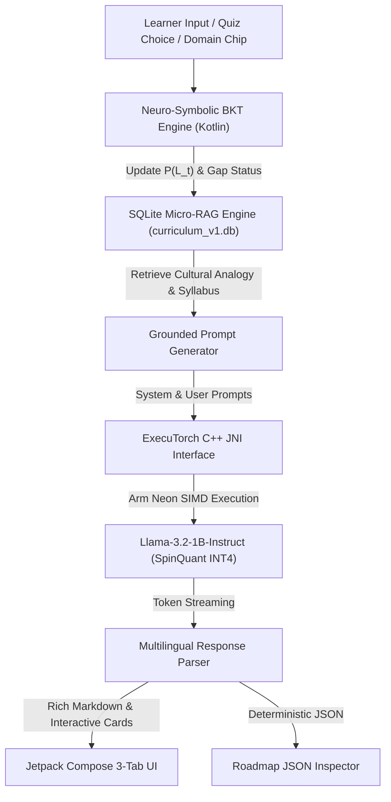

# System Architecture & Technical Pipeline

The **Bharat AI-SoC PS4 Personalised AI Learning Companion** is an edge-native, 100% offline educational system combining **Bayesian Knowledge Tracing (BKT)**, **Embedded Micro-RAG**, and **Quantized Large Language Models (ExecuTorch INT4)**.

---

## 1. High-Level Architecture

The end-to-end pipeline executes entirely within the Android application process without any network communication:



---

## 2. Neuro-Symbolic Bayesian Knowledge Tracing (BKT)

### 2.1 Theoretical Formulation
Bayesian Knowledge Tracing is a Hidden Markov Model used to estimate the probability $P(L_t)$ that a learner has mastered a specific skill node at step $t$, given their sequence of observed quiz responses.

The BKT engine operates with four fixed pedagogical parameters:
- **$P(L_0)$ (Initial Prior):** Baseline probability of prior mastery (domain specific, between $0.15$ and $0.40$).
- **$P(T)$ (Probability of Transit):** Probability that a learner transitions from unmastered to mastered state upon exposure ($P(T) = 0.20$).
- **$P(S)$ (Probability of Slip):** Probability that a learner who knows the skill makes an accidental mistake ($P(S) = 0.10$).
- **$P(G)$ (Probability of Guess):** Probability that a learner who does not know the skill guesses correctly on a 4-option quiz ($P(G) = 0.25$).

### 2.2 Posterior Update Equations
When an observation is recorded (correct or incorrect):

1. **If the learner answers correctly:**
   $$P(L_t \mid \text{correct}) = \frac{P(L_{t-1}) \cdot (1 - P(S))}{P(L_{t-1}) \cdot (1 - P(S)) + (1 - P(L_{t-1})) \cdot P(G)}$$

2. **If the learner answers incorrectly:**
   $$P(L_t \mid \text{incorrect}) = \frac{P(L_{t-1}) \cdot P(S)}{P(L_{t-1}) \cdot P(S) + (1 - P(L_{t-1})) \cdot (1 - P(G))}$$

3. **Transition Step (Learning Event):**
   $$P(L_t) = P(L_t \mid \text{obs}) + (1 - P(L_t \mid \text{obs})) \cdot P(T)$$

The resulting probability is constrained between $0.05$ and $0.99$ to avoid probability saturation:
```kotlin
val pNext = (pObs + (1.0 - pObs) * pTransit).coerceIn(0.05, 0.99)
```

### 2.3 Adaptive Study Allocation & Foundational Gap Remediation
The engine classifies mastery into three distinct operational states:
- **Critical Foundational Gap ($P(L_t) < 0.45$):** The learner lacks prerequisite mastery. The companion automatically flags this state, triggers remedial guidance, and increases the allocated weekly study hours by $+2\text{h/week}$ (e.g., $8\text{h} \to 10\text{h/week}$).
- **In-Progress Module ($0.45 \le P(L_t) < 0.80$):** Standard progression with active problem-solving exercises.
- **Mastered Review Ready ($P(L_t) \ge 0.80$):** The skill is retained; weekly hours are reduced to maintenance levels, and next-stage prerequisites are unlocked.

---

## 3. Embedded Curriculum Micro-RAG Engine

### 3.1 Motivation
Standard RAG frameworks rely on heavy vector embedding models and remote vector databases (e.g., Pinecone, ChromaDB), which cannot run under mobile memory constraints ($<1.8\text{ GB}$).

The companion utilizes **SQLite Full-Text Search (FTS5)** running directly inside the app process. It operates with zero networking, requires less than $50\text{ KB}$ of storage, and achieves retrieval latency under $2\text{ ms}$.

### 3.2 Database Architecture
The SQLite database (`curriculum_v1.db`) contains two synchronized tables:
1. **`skills_catalog` (Relational Table):**
   - Stores `skill_id`, `domain_category`, `prerequisite_ids`, `base_hours`, `default_p_l0`, `syllabus_en`, and `diagnostic_quiz_json`.
2. **`indic_content_fts` (FTS5 Virtual Table):**
   - Full-text indexed table storing `skill_id`, `lang_code`, `localized_title`, `cultural_analogy`, and `syllabus_localized`.

### 3.3 Prompt Grounding Pipeline
When a user submits a query or clicks a chip:
1. `matchSkillForQuery()` identifies the target skill node.
2. `getLocalizedContent()` fetches the localized title, syllabus, and cultural analogy for the selected language.
3. A grounded system prompt is generated to constrain the model:
   ```kotlin
   val sysPrompt = "You are Bharat AI Tutor running offline on Arm ExecuTorch. " +
       "Syllabus Context: ${localized.syllabusLocalized}. " +
       "Learner BKT mastery is $masteryPct% ($status). " +
       "Provide technical instruction and a 3-step roadmap STRICTLY in $langName. DO NOT use JSON format. Respond with natural text and bullet points."
   ```
4. A grounded user prompt ensures the requested language is adhered to:
   ```kotlin
   val usrPrompt = "$trimmed (Explain ${localized.localizedTitle} in $langName using technical terms but simplified for $masteryPct% mastery)"
   ```

---

## 4. ExecuTorch On-Device Inference Runtime

### 4.1 Model & Quantization Strategy
- **Base Architecture:** Llama-3.2-1B-Instruct (16 layers, 2048 hidden dimension, 32 attention heads).
- **Quantization:** **SpinQuant INT4 with EO8** (Equivalent Optimization 8-bit activations). SpinQuant applies randomized Hadamard orthogonal rotations to remove outlier activation channels, enabling aggressive 4-bit weight compression with minimal perplexity degradation.
- **Model Size:** $1.13\text{ GB}$ (`Llama-3.2-1B-Instruct-SpinQuant_INT4_EO8.pte`).
- **Tokenizer:** SentencePiece BPE tokenizer ($2.18\text{ MB}$, `tokenizer.model`).

### 4.2 Arm Neon SIMD & Memory Footprint Bounds
The ExecuTorch runtime leverages **XNNPACK** compiled with Arm64 Neon SIMD assembly optimizations:
- Vectorized 4-bit integer matrix-vector multiplication kernels.
- Model weights memory-mapped directly from flash storage (`/data/local/tmp/llama/`), preventing unnecessary memory duplication in JVM heap.
- Hardcoded generation limit of 384 tokens (`module?.generate(finalPrompt, 384, this, false)`) to cap KV-cache allocation.
- Resulting total process RSS memory stays strictly bounded between **$1631\text{ MB}$ (idle)** and **$1700\text{ MB}$ (peak generation)**, satisfying the PS4 criterion of strictly $< 1800\text{ MB}$.

---

## 5. Crash-Proof Deterministic JSON Synthesis

To eliminate UI crashes caused by malformed LLM outputs:
1. The companion creates the structured JSON data **deterministically in Kotlin** based on verified database records.
2. The LLM is directed to produce natural markdown prose rather than raw JSON strings.
3. The UI components display verified metadata in native Compose widgets and offer an expandable **Roadmap JSON Inspector** for developers and evaluators to inspect valid JSON schemas.
