# Curriculum Micro-RAG & Vernacular Database

The **Bharat AI-SoC Companion** incorporates a curated curriculum database and on-device retrieval system designed to meet all domain and localization requirements of Problem Statement 4.

---

## 1. Six Target Curriculum Domains & Eight Skill Nodes

The curriculum spans six foundational domains specified by PS4, structured into eight interconnected skill nodes forming a Directed Acyclic Graph (DAG):

```mermaid
graph TD
    ml01["ml_01_linalg<br/>(Linear Algebra)"] --> ml02["ml_02_pytorch<br/>(PyTorch Autograd)"]
    ml02 --> ml03["ml_03_edge_quant<br/>(Edge AI Quantization)"]

    subgraph "Technical Roadmaps"
        ml01
        ml02
        ml03
    end

    subgraph "Exam Preparation"
        gate["exam_01_gate_os<br/>(GATE CS Operating Systems)"]
    end

    subgraph "Certification Paths"
        sec["cert_01_cloud_sec<br/>(Cloud Security & IAM)"]
    end

    subgraph "Career Guidance"
        data["career_01_data_analyst<br/>(SQL Data Analytics)"]
    end

    subgraph "Skill Development"
        py["skill_01_python_ds<br/>(Python & Pandas)"]
    end

    subgraph "Lifelong Learning"
        habit["life_01_micro_habit<br/>(Spaced Repetition Habits)"]
    end
```



---

## 2. Skill Catalog Specification

| Skill ID | Domain Category | Prereqs | Base Hours | Default $P(L_0)$ | Diagnostic Quiz Focus |
| :--- | :--- | :--- | :---: | :---: | :--- |
| **`ml_01_linalg`** | Technical Roadmaps | None | 6 h/wk | 0.30 | Matrix multiplication dimensions (e.g. $3\times 4 \times 4\times 2 \to 3\times 2$). |
| **`ml_02_pytorch`** | Technical Roadmaps | `ml_01_linalg` | 10 h/wk | 0.25 | Computational autograd graphs and `loss.backward()`. |
| **`ml_03_edge_quant`** | Technical Roadmaps | `ml_02_pytorch` | 10 h/wk | 0.15 | ExecuTorch INT4 weight quantization and Arm Neon SIMD efficiency. |
| **`exam_01_gate_os`** | Exam Preparation | None | 8 h/wk | 0.35 | CPU scheduling optimality (Shortest Job First / SJF) and deadlocks. |
| **`cert_01_cloud_sec`** | Certification Paths | None | 8 h/wk | 0.25 | Principle of Least Privilege in cloud IAM policies. |
| **`career_01_data_analyst`** | Career Guidance | None | 7 h/wk | 0.30 | SQL aggregate filtering using the `HAVING` clause. |
| **`skill_01_python_ds`** | Skill Development | None | 6 h/wk | 0.35 | Data aggregation with Pandas `df.groupby()`. |
| **`life_01_micro_habit`** | Lifelong Learning Plans | None | 4 h/wk | 0.40 | Ebbinghaus forgetting curve flattening via spaced repetition. |

---

## 3. SQLite Database Schema & Architecture

The database (`curriculum_v1.db`) is constructed via `build_curriculum_db.py` using standard SQLite 3 and the FTS5 full-text search module.

### 3.1 Relational Schema (`skills_catalog`)
```sql
CREATE TABLE skills_catalog (
    skill_id TEXT PRIMARY KEY,
    domain_category TEXT NOT NULL,
    prerequisite_ids TEXT NOT NULL,       -- JSON array of strings, e.g. '["ml_01_linalg"]'
    base_hours INTEGER NOT NULL,          -- Recommended baseline weekly study hours
    default_p_l0 REAL NOT NULL,           -- Baseline BKT prior probability P(L_0)
    syllabus_en TEXT NOT NULL,            -- Detailed English curriculum syllabus
    diagnostic_quiz_json TEXT NOT NULL    -- JSON array of diagnostic assessment questions
);
```

### 3.2 Full-Text Search Schema (`indic_content_fts`)
```sql
CREATE VIRTUAL TABLE indic_content_fts USING fts5(
    skill_id,
    lang_code,                            -- 'en', 'hi', 'ta', 'te', 'bn', 'mr'
    localized_title,
    cultural_analogy,                     -- Vernacular everyday analogy
    syllabus_localized
);
```

### 3.3 Asset Packaging & Deployment
1. When compiled, `curriculum_v1.db` has a compact footprint of approximately $40\text{ KB}$.
2. The database file is placed in `app/src/main/assets/curriculum_v1.db`.
3. On application boot, `CurriculumRagEngine.ensureDatabaseCopied()` copies the file to the app's internal database directory (`context.getDatabasePath("curriculum_v1.db")`).
4. Read-only connections (`SQLiteDatabase.OPEN_READONLY`) are opened per operation, ensuring thread-safe access with zero file lock contention.

---

## 4. Vernacular Cultural Analogies

A distinctive pedagogical feature is the grounding of abstract technical topics in familiar cultural metaphors across 6 Indian languages:

### 4.1 Linear Algebra & Matrix Multiplication (`ml_01_linalg`)
- **English:** *"Think of matrix multiplication like combining daily train routes across junctions to calculate total passenger flow."*
- **Hindi (`hi`):** *"मैट्रिक्स गुणन को रेलवे जंक्शन के रूट चार्ट की तरह समझें—जहाँ अलग-अलग पटरियों का डेटा मिलकर कुल यात्री प्रवाह बताता है।"*
- **Tamil (`ta`):** *"அணி பெருக்கலை (Matrix Multiplication) ஒரு சமையல் குறிப்பில் பல பொருட்களின் அளவுகளை ஒரே நேரத்தில் கணக்கிடுவதற்கு ஒப்பிடலாம்."* (Comparing matrix math to calculating proportional spice ingredients for grand culinary recipes).
- **Telugu (`te`):** *"మ్యాట్రిక్స్ గుణకారాన్ని రైల్వే జంక్షన్లలో వివిధ మార్గాల ప్రయాణికుల సంఖ్యను ఒకేసారి లెక్కించడంతో పోల్చవచ్చు."*
- **Bengali (`bn`):** *"ম্যাট্রিক্স গুণনকে একটি বড় বাজারের পাইকারি হিসাবের খাতার মতো ভাবুন, যেখানে দাম ও পরিমাণের সারিগুলো একসাথে গুণ হয়ে মোট খরচ বের করে।"* (Comparing matrix dot products to wholesale bazaar ledgers multiplying item prices by bulk quantities).
- **Marathi (`mr`):** *"मॅट्रिक्स गुणाकार म्हणजे एसटी बस डेपोच्या वेळापत्रकासारखा आहे—जिथे अनेक मार्गांवरील प्रवाशांची एकत्रित संख्या एकाच वेळी मोजली जाते।"* (Comparing matrix calculation to Maharashtra State Transport bus junction scheduling).

### 4.2 Cloud IAM Least Privilege (`cert_01_cloud_sec`)
- Analogized to a multi-tiered temple treasury or bank locker system where keys are issued exclusively for the specific vault required, preventing unauthorized access even if an outer door is compromised.

### 4.3 Spaced Repetition Habits (`life_01_micro_habit`)
- Analogized to systematic agricultural drip irrigation—nourishing the soil with measured daily water rather than drowning crops in a seasonal deluge.

---

## 5. Diagnostic Quiz Pools

Each skill node contains diagnostic multiple-choice questions stored in `diagnostic_quiz_json`. 

Example question for `ml_03_edge_quant`:
```json
[
  {
    "q": "Why do we quantize FP16 weights to INT4 on Arm mobile SoCs?",
    "options": [
      "Reduces RAM footprint by ~4x and accelerates SIMD matrix math",
      "Increases parameter count",
      "Requires cloud GPU connectivity",
      "Eliminates the tokenizer"
    ],
    "ans": 0
  }
]
```

When a learner answers, `CurriculumRagEngine.updateBktMastery()` evaluates the answer against the correct index and updates the probability $P(L_t)$ dynamically.
