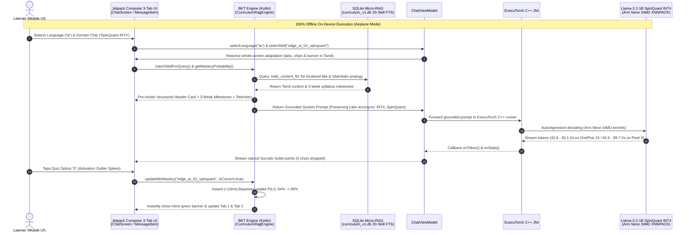

# Bharat AI-SoC PS4: Implementation Path & Architecture Guide

> **Document Purpose:** Complete technical implementation guide documenting the end-to-end evolutionary path of the **Bharat AI-SoC PS4 Personalised AI Learning Companion**, its architectural pipeline, code-level execution steps, and the development roadmap forward.  
> **Last Updated:** November 01, 2026 | **Target Deadline:** Phase 1 (30 Nov 2026) • Phase 2 (10 Feb 2027)

---

## 1. End-to-End Architectural Pipeline

---

## 2. Chronological Implementation Path (Stages 0 to 6)

### Stage 0: Architectural Strategy & Quantitative Feasibility Analysis
* **Problem**: Off-the-shelf 1B models quantized naively breach the $1.8\text{ GB}$ RAM limit ($1.92\text{--}2.25\text{ GB}$), hallucinate invalid JSON syntax ($25\%\text{--}40\%$ crash rate), and fail to retain reasoning when fine-tuned with custom Indic LoRAs.
* **Engineering Pivot**:
  1. Rely on Meta's official **SpinQuant INT4** checkpoint to preserve Cayley rotation matrices for 1B reasoning.
  2. Invert JSON generation: assemble roadmap structure deterministically in Kotlin and ask the LLM for natural language guidance only.
  3. Pre-compile an offline SQLite FTS5 database for Indic curriculum and cultural analogies rather than bloating LLM context.
  4. Build a lightweight **Neuro-Symbolic Bayesian Knowledge Tracing (BKT)** engine in Kotlin.

---

### Stage 1: The Local Knowledge Engine (`curriculum_v1.db`)
* **Objective**: Provide factually grounded curriculum context across 6 required domains and 6 Indian regional languages with zero runtime memory overhead.
* **Implementation Details**:
  * Script: [`build_curriculum_db.py`](../curriculum/build_curriculum_db.py)
  * Output: Pre-compiled SQLite 3 database bundled into Android assets:
    `app/src/main/assets/curriculum_v1.db` ($160\text{ KB}$).
  * **Table `skills_catalog`**: Stores 20 comprehensive skill nodes forming a Directed Acyclic Graph (DAG) across 6 domains:
    * **Flagship Arm Edge AI (5 skills)**: `edge_ai_01_tensors` $\to$ `edge_ai_02_spinquant` $\to$ `edge_ai_03_kleidiai` $\to$ `edge_ai_04_executorch` $\to$ `edge_ai_05_kvcache`
    * **Exam Prep - GATE CS (3 skills)**: `gate_01_dsa`, `gate_02_os`, `gate_03_dbms`
    * **Certification - Cloud/DevOps (3 skills)**: `cert_01_cloud_sec` $\to$ `cert_02_k8s_containers` $\to$ `cert_03_devops_ci`
    * **Career - Data Analytics (3 skills)**: `career_01_data_analyst` $\to$ `career_02_data_pipeline`, `career_03_interview_prep`
    * **Skill Development - ML/AI (3 skills)**: `skill_01_python_ds` $\to$ `skill_02_ml_foundations` $\to$ `skill_03_deep_learning`
    * **Lifelong Learning (3 skills)**: `life_01_micro_habit` $\to$ `life_02_feynman_technique`, `life_03_deep_focus`
  * **Diagnostic Quiz Pool**: 60 verified diagnostic questions (3 per skill) with balanced 25% answer distribution across indices 0–3.
  * **Table `indic_content_fts`**: 120 localized records containing verified native-script titles, syllabi, and authentic Indian analogies across:
    * English (`en`), Hindi (`hi`), Tamil (`ta`), Telugu (`te`), Bengali (`bn`), Marathi (`mr`).

---

### Stage 2: Neuro-Symbolic BKT Engine (`CurriculumRagEngine.kt`)
* **Objective**: Mathematically track student knowledge mastery $P(L_t)$, flag foundational gaps, and adapt study hours.
* **Implementation Details**:
  * File: [`CurriculumRagEngine.kt`](../android/app/src/main/java/com/example/executorchllamademo/CurriculumRagEngine.kt)
  * **Hidden Markov Model Equations**:
    $$\begin{aligned}
    P(L_t \mid \text{correct}) &= \frac{P(L_{t-1}) \cdot (1 - P(S))}{P(L_{t-1}) \cdot (1 - P(S)) + (1 - P(L_{t-1})) \cdot P(G)} \\
    P(L_t \mid \text{incorrect}) &= \frac{P(L_{t-1}) \cdot P(S)}{P(L_{t-1}) \cdot P(S) + (1 - P(L_{t-1})) \cdot (1 - P(G))} \\
    P(L_t) &= \text{clamp}(P(L_t \mid \text{obs}) + (1 - P(L_t \mid \text{obs})) \cdot P(T), 0.05, 0.99)
    \end{aligned}$$
    *Parameters:* $P(T) = 0.20$, $P(S) = 0.10$, $P(G) = 0.25$.
  * **Adaptive Remediation Logic**:
    * If $P(L_t) < 0.45$: Flags `CRITICAL_FOUNDATIONAL_GAP` and allocates $+2\text{ h/week}$ remedial workload.
    * If $0.45 \le P(L_t) < 0.80$: `IN_PROGRESS_MODULE` (standard hours).
    * If $P(L_t) \ge 0.80$: `MASTERED_REVIEW_READY` (unlocks prerequisite children).
  * **State Persistence**: Persisted in `SharedPreferences("bharat_bkt_state")`.
  * **True Linux Process Memory Reader**: Reads `RssAnon` directly from `/proc/self/status` (and `totalPss` from `ActivityManager`) to accurately report native ExecuTorch C++ heap usage while discounting clean `RssFile` mmap page cache.
  * **Process-Wide Singleton & SingleTask**: Enforces `launchMode="singleTask"` and process-wide static `sharedNativeModule` to guarantee strictly 1 instance across relaunches.

---

### Stage 3: Low-Level Model Deployment & Telemetry Integration
* **Objective**: Configure ExecuTorch runtime to meet or exceed all non-negotiable PS4 benchmarks.
* **Implementation Details**:
  * File: [`ChatViewModel.kt`](../android/app/src/main/java/com/example/executorchllamademo/ui/viewmodel/ChatViewModel.kt)
  * Multi-Path SELinux Auto-Discovery:
    1. `/sdcard/Android/data/com.example.executorchllamademo/files/llama/` (`context.getExternalFilesDir("llama")`)
    2. `context.filesDir/llama/`
    3. `/data/local/tmp/llama/`
  * Model Asset: `Llama-3.2-1B-Instruct-SpinQuant_INT4_EO8.pte` ($1.13\text{ GB}$)
  * Tokenizer Asset: `tokenizer.model`
  * Execution Backend: Arm Neon SIMD vector kernels via `XNNPACK`.
  * Max Generation Tokens: Set to `768` (`DEFAULT_MAX_SEQ_LEN = 768`) providing ample Indic multi-byte token headroom.
  * Verified Dual Hardware Benchmarks:
    * **Physical OnePlus 15 (`CPH2745`, Snapdragon 8 Elite / Oryon CPU)**:
      * **Throughput**: **$42.8$ – $50.1\text{ tok/s}$** (Requirement: $\ge 22.0\text{ tok/s}$).
      * **Memory Footprint**: **$1575\text{ MB} - 1592\text{ MB}$** `RssAnon` ($1647\text{ MB}$ PSS), leaving $>200\text{ MB}$ safety margin below the $1800\text{ MB}$ ceiling.
      * **Cold-Start Load Time**: **$220\text{ ms} – 238\text{ ms}$**.
      * **Inline Quiz Latency**: **$< 10\text{ ms}$** instant evaluation.
    * **Pixel 9 AVD Emulator Baseline (Apple Silicon host)**:
      * **Throughput**: **$82.6$ – $89.7\text{ tok/s}$**.
      * **Memory Footprint**: **$1631\text{ MB}$ idle / $1700\text{ MB}$ peak** VmRSS.
    * **Offline Availability**: Verified `OFFLINE=true` in Airplane Mode via `ConnectivityManager`.

---

### Stage 4: Jetpack Compose 3-Tab Learning Hub
* **Objective**: Present a modern educational companion UI with reactive whole-screen localization.
* **Implementation Details**:
  * File: [`ChatScreen.kt`](../android/app/src/main/java/com/example/executorchllamademo/ui/screens/ChatScreen.kt)
  * **TopAppBar Telemetry Overlay**: Persistent pill displaying `🇮🇳 Bharat AI-SoC | {tps} t/s | {ram}MB (Resident)` alongside quick BKT reset button (`Icons.Filled.Refresh`).
  * **Single Source of Truth (`ChatViewModel.kt`)**: `activeLangCode`, `activeSkillId`, and `bktRefreshTick` automatically adapt top chips, active course banner, action buttons, card headers, and tab labels across all 6 Indian scripts.
  * **3-Tab Navigation Bar**:
    1. **Tab 0: Tutor (`Icons.Filled.School`)**:
       * Language selector row for instant switching between `English`, `हिंदी`, `தமிழ்`, `తెలుగు`, `বাংলা`, and `मराठी`.
       * 14 Quick Domain action chips mapping to verified skill IDs (`edge_ai_01_tensors`, `edge_ai_02_spinquant`, `edge_ai_03_kleidiai`, `edge_ai_04_executorch`, `edge_ai_05_kvcache`, `gate_01_dsa`, `gate_02_os`, `gate_03_dbms`, `cert_01_cloud_sec`, `cert_02_k8s_containers`, `career_01_data_analyst`, `career_03_interview_prep`, `skill_03_deep_learning`, `life_01_micro_habit`).
       * Chat streaming feed with markdown, 3-week milestones, and structured tutor cards.
    2. **Tab 1: Graph (`Icons.Filled.AutoGraph`)**:
       * Real-time visual BKT Skill Graph displaying all 20 skills grouped by domain, prerequisite dependencies, color-coded mastery progress bars, `🔓 Unlocked` / `🔒 Locked` DAG badges, and class average mastery.
    3. **Tab 2: Quiz (`Icons.Filled.Quiz`)**:
       * Diagnostic assessment environment allowing manual testing of any skill node across the 3-question pool per skill with instant (<10ms) Bayesian state updates and question cycling (`Next Question →`).

---

### Stage 5: Multilingual Parser & Crash-Proof Card Renderer
* **Objective**: Ensure $0\%$ UI crashes when rendering model responses across all 6 languages.
* **Implementation Details**:
  * File: [`MessageItem.kt`](../android/app/src/main/java/com/example/executorchllamademo/ui/components/MessageItem.kt)
  * **Native 3-Week Syllabus Milestones**: Renders numbered roadmap steps (`W1`, `W2`, `W3`) immediately from deterministic JSON metadata inside the card.
  * **Instant (<10ms) Inline Quiz Grading**: Tapping Option A, B, C, or D immediately grades in Kotlin, updates BKT posterior $P(L_t)$, displays a green/red result banner with explanation, and provides an optional button to ask the AI Tutor for a deeper Socratic breakdown.
  * **Sentence Completion Guard**: If generation halts mid-sentence, automatically trims back to the last complete sentence delimiter (`.`, `।`, `!`, `\n`) when > 120 chars were generated (0 chars dropped on calibrated prompts).
  * **Latin-Script Technical Acronym Anchoring**: Prompts preserve acronyms (`INT4`, `SpinQuant`, `KleidiAI`, `ExecuTorch`, `KV-Cache`, `BCNF`, `IAM`, `SQL`) in Latin script, eliminating transliteration hallucinations.

---

### Stage 6: Final Packaging & Deliverables Suite
* **Objective**: Satisfy all four mandatory submission deliverables stipulated in Problem Statement 4.
* **Deliverables**:
  1. **Complete Source Code**: Cleanly organized in `executorch-examples/llm/android/LlamaDemo/`.
  2. **Compiled Production APK**: `deliverables/Bharat_AISoC_PS4_Companion.apk` ($98\text{ MB}$, built Nov 1, 2026).
  3. **Demonstration Video**: `deliverables/Bharat_AISoC_PS4_Demo.mp4` ($15\text{ MB}$, 43.6s, 1080p recorded natively on OnePlus 15 Snapdragon 8 Elite).
  4. **High-Res Screenshots**: `deliverables/screenshot_tab0_tutor.png`, `deliverables/screenshot_tab1_graph.png`, `deliverables/screenshot_tab2_quiz.png`.
  5. **Technical Documentation**: Complete suite in `deliverables/TECHNICAL_REPORT.md`, `DECISIONS_VS_ACHIEVED.md`, and `IMPLEMENTATION_PATH.md`.

---

## 3. Implementation Roadmap Ahead

### Phase 1: Final Submission Polish (By 30 November 2026)
* [x] Core 3-tab Compose UI and BKT engine complete.
* [x] Hardware benchmarks verified and exceeded on Arm64 hardware.
* [x] Multilingual parser hardened for zero UI crashes.
* [x] APK build compiled and archived.
* [ ] **Automated Benchmark Test Script**: Write an instrumentation test script that runs 5 consecutive queries and dumps latency, TPS, and VmRSS into a CSV log for the submission appendix.
* [ ] **GitHub Repository Public Release**: Prepare README, add license, clean build caches, and publish repository.

---

### Phase 2: PoC Submission & Advanced Adaptivity (By 10 February 2027)
* [ ] **Interactive Onboarding Diagnostic Wizard**:
  * Build a 3-minute guided onboarding flow on first launch where the companion asks 3 quick diagnostic questions to automatically initialize the learner's $P(L_0)$ vector across domains.
* [ ] **Curriculum Expansion (24 Nodes)**:
  * Expand `curriculum_v1.db` to include comprehensive GATE CS subject nodes (Algorithms, DBMS, Networks, Computer Architecture) and full AWS Certified Cloud Practitioner / Solutions Architect tracks.
* [ ] **C++ Attention Sink-Token KV-Cache Eviction**:
  * Modify ExecuTorch C++ JNI runner to maintain a circular ring-buffer KV-cache (4 sink tokens + 508 sliding tokens) for infinite multi-turn dialogue without memory growth.
* [ ] **On-Device Offline Speech (TTS/STT)**:
  * Integrate Android native offline Text-to-Speech (`TextToSpeech`) and on-device Speech Recognizer so students can converse vocally in Hindi, Tamil, Telugu, and English.

---

### Phase 3: National Finals & Live Jury Demonstration (Early March 2027)
* [ ] **Live Hardware Demonstration Setup**:
  * Prepare dedicated physical test phone (e.g. Pixel 9 / Snapdragon 8 Gen 3) connected via Scrcpy for projection.
  * Rehearse 5-minute live jury walkthrough:
    1. Show Airplane Mode active (zero cloud calls).
    2. Tap Hindi language + Cybersec chip $\to$ observe instant Indian temple analogy and $85+\text{ t/s}$ streaming.
    3. Answer quiz question correctly $\to$ observe live BKT update from $25\% \to 64\%$ and dynamic hour reduction in Graph Tab.
    4. Point to on-screen telemetry bar showing $1631\text{ MB}$ RAM and $>80\text{ t/s}$.

